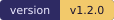

  

This project can be used on [zodiac.supermaestro.org](https://zodiac.supermaestro.org)

# Magic

## What Magic is

A page for magic lovers, in three steps:

1. **Self Discovery**: your own sky.
2. **Soul Affinity**: how you and another soul fit together.
3. **Friends hidden codes**: the people who shared their details with you, kept in your browser.

It is free and needs no account. Everything is for wonder, not science.

## Self Discovery

You enter your birth date, birth time and birth city. You can add a name and a current city.

You get:

- Your Sun, Ascendant and Moon signs, each with a History link that tells the Greek myth of the sign.
- Mercury to Pluto and the North Node, with retrograde marks (births from 1800 to 2100).
- The Midheaven and the house of each body.
- The signs in tune with you and the sign of the love of your life.
- Born under: the Moon phase on your birth day.
- Today's sky: the Moon phase and a short reading for the day.
- Three biorhythms (physical, emotional, intellectual) with their next peaks and low points.
- A chart wheel (next section).
- A print button and a print layout without forms.

Buttons:

- **Reveal my sky** shows the report.
- **Save the data** keeps your details in your browser without showing the report.
- **Generate hidden data code** makes a link and a QR code for a friend (see "Hidden data codes").
- **Clear data** erases what your browser remembers.

## The chart wheel

The wheel is a round picture of the sky at the moment and place of birth.

- The outer ring holds the twelve signs.
- Each planet is drawn with its symbol where it stood.
- The numbers 1 to 12 mark the twelve houses, which stand for areas of life such as home, work and relationships.
- The left edge marks the Ascendant and the top marks the Midheaven.
- A table beside the picture lists the same positions in words. It is the exact version.
- Symbols that would overlap are moved slightly apart so they stay readable.
- The wheel can be collapsed and it prints with the report.

## Soul Affinity

It is locked until your Self Discovery data is stored. It then uses your data, so you never type yourself again.

For the other soul, the name is enough. Date, time and city are optional, and each detail unlocks more results.

You get:

- A first line with three values: Attraction, Harmony (how peaceful the two of you are likely to be together) and Fights.
- Your connection in three cards: a Past, Present and Future tarot spread from a deck of 78 cards. The same people on the same day draw the same cards.
- Biorhythm synchrony of the two of you, cycle by cycle, with the next days you are both high or both low (needs both birth dates).
- What you have in common in Sun, Moon and Ascendant.
- Synastry: the best links between the two charts (the five closest harmonious ones) and the hardest (the three closest tense ones), each with a short meaning.

The three values always sit side by side with bars of the same length, also on phones. A printed Soul Affinity reading fits on a single page, opening with these three values.

Percentages are drawn as bars; the number shows in a small bubble when you point at a bar or reach it with the keyboard, and it is always printed.

You can also fill the other soul from a friend's hidden code ("Import from a user", by pasting the link or scanning the QR code) and give them a nickname that stays on your device. Once the result for such a friend is shown, it starts right away, with no form box above it.

## Friends hidden codes

It is locked until your Self Discovery data is stored, and needs a browser that allows storage.

The hidden codes your friends sent you are listed with a nickname you choose. You can:

- Search by nickname.
- Rename a friend.
- Remove one friend, or select several and remove them together.
- Press Compare to open the Soul Affinity result at once.

The list lives only in your browser. The details inside a code are never shown in the list.

## Hidden data codes

Generate hidden data code gives you:

- A link and a QR code, which you can copy or scan.
- A **Share on WhatsApp** button that opens WhatsApp with the link ready to send.

The person who opens it compares themselves with you without typing your details, and their screen does not show your name, birth data or place. The result calls you by the nickname they chose, or "Your match".

Be honest with yourself about what it is: the code is an **encoding, not encryption**. It is not a secret. Anyone who holds the link or the QR code can unpack it and read your name, birth date, time and place. Send it only to someone you trust. If you use WhatsApp, the link also passes through that service.

## Sharing a Soul Affinity reading

When the other soul was typed in, the result has a Share section:

- A **frozen link** that opens exactly the reading you saw: same day and same tarot cards.
- A **live link** with the same people and the viewer's own today.
- A small QR code, a Copy link button and a Share button where the browser has them.

There is no share link in these cases:

- Self Discovery results have none.
- A Soul Affinity result built from a friend's hidden data has none.

Share links contain the names and birth details that were typed. They are not encrypted, so share them only with people you trust. Old shared links keep working.

## Where you are now

A current city is optional. When you give one:

- It decides which calendar day counts as today for biorhythms, tarot and Today's sky.

Without it, today is the server's date.

## Remembered in your browser

If your browser allows it, Magic remembers on your device only:

- Your own details.
- A short list of people you looked up.
- Your friends' hidden codes and nicknames.

None of it is stored by the server. Clear data erases all of it, and so does withdrawing your acceptance of the Terms. If the browser blocks storage, the page says so and keeps working without memory.

## Terms and privacy

- On the first visit a popup asks you to accept the Terms and Conditions. Until you do, nothing is processed or recorded. The same text is at the end of the page, where you can withdraw.
- Each result is recorded in an audit log: names, birth details, places and a summary of the result. Not recorded: your address, your browser, the address you visited.
- Only the city text is sent to a free geocoding service to find the place. Nothing is used for tracking.
- One functional cookie remembers your acceptance.
- Records are not deleted automatically. The owner removes them by hand or on request.
- Result addresses contain the typed details, so they are not indexed by search engines.

## Limits

- Planets are approximate and available for births from 1800 to 2100. Sun and Moon are very accurate.
- The Ascendant, houses and wheel are approximate at extreme latitudes and are marked so.
- A person with only a birth date has an approximate chart.
- One house system, tropical zodiac only, English only.
- Attraction, Harmony, Fights, biorhythms, scores, myths and tarot are for wonder, not science.

For running, testing and deploying the project, read [DEVELOPER.md](DEVELOPER.md). More documents are in the [docs](docs/) folder.
